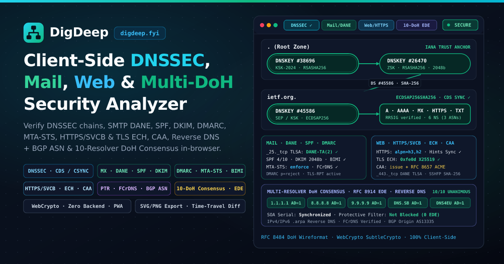

# DigDeep — Client-Side DNSSEC, Mail, Web/HTTPS & Multi-DoH Analyzer

[](https://digdeep.fyi/)

**DigDeep** ([digdeep.fyi](https://digdeep.fyi/)) is a 100% client-side DNS security analyzer, **DNSViz** chain-of-trust visualizer, and **RFC 8484 DNS-over-HTTPS (DoH)** wire packet inspector that runs entirely in the browser using **WebCrypto (`SubtleCrypto`)** with zero backend servers.



---

## Analysis Modes & Capabilities

### 1. DNSSEC Chain-of-Trust Visualizer (`?mode=dnssec`)
- **100% In-Browser Cryptographic Verification**: Uses `SubtleCrypto` to verify `DS` → `DNSKEY` digests (`SHA-1`, `SHA-256`, `SHA-384`) from the IANA Root KSK trust anchors (`#38696` KSK-2024 & `#20326` KSK-2017) and canonical wireformat `RRSIG` signatures (`RSASHA1`, `RSASHA256`, `RSASHA512`, `ECDSAP256SHA256`, `ECDSAP384SHA384`, `ED25519`).
- **Authenticated Denial of Existence**: Validates `NSEC` and `NSEC3` (including `Opt-Out`, RFC 9276 iteration count audits, wildcard synthesis, and Compact Denial of Existence / Cloudflare *Black Lies*).
- **Key Rollover & Zone Resilience Audit**:
  - Audits **`CDS` / `CDNSKEY` (RFC 7344 / RFC 8078)** and **`CSYNC` (RFC 7477)** records against parent `DS` records to detect pending KSK rollovers or unapplied `DS` updates.
  - Evaluates **Authoritative Nameserver BGP ASN & Subnet Diversity** (`single-asn` SPOF warnings), **SOA Timer Compliance** (RFC 1912 / RFC 4035), and **Dangling `NS` / `CNAME` Subdomain Takeover** risks.
- **Interactive DAG Graph & Export**: Pan/zoom hierarchical zone containers, double-ring SEP/KSK capsules, phantom missing-key nodes (e.g. `dnssec-failed.org`), cross-zone `CNAME` arcs (e.g. `www.iana.org`), time-travel RRSIG clock override, and standalone **SVG / high-DPI PNG** export.

### 2. Mail, SMTP DANE, SPF, DKIM, DMARC, MTA-STS & BIMI (`?mode=mail`)
- **MX Routing & FCrDNS**: Resolves `MX` priorities, `A`/`AAAA` addresses, reverse `PTR` records, and Forward-Confirmed Reverse DNS (`FCrDNS`) per mail exchanger.
- **SMTP DANE (`_25._tcp.<mx>` `TLSA` — RFC 7671 / RFC 7672)**: Validates `TLSA` records across every `MX` host, enforces mandatory DNSSEC chain-of-trust prerequisites, and highlights `DANE-TA(2)` / `DANE-EE(3)` operational best practices.
- **Recursive SPF (`v=spf1` — RFC 7208)**: Recursively walks `include:`, `redirect=`, `a`, `mx`, `ptr`, and `exists` mechanisms to audit the strict **10-DNS-lookup limit**, void-lookup limit, and `all` qualifier strength.
- **DKIM (`<selector>._domainkey` — RFC 6376 / RFC 8301 / RFC 8463)**: Auto-discovers common selectors (plus custom selector input), follows cross-zone `CNAME` delegations, and inspects RSA key bit lengths (`1024` / `2048` / `4096`-bit) and `ed25519` keys.
- **DMARC (`_dmarc` — RFC 7489 / RFC 9091)**: Audits `p=`, `sp=`, `pct=`, `adkim=`, `aspf=`, `rua=`, and `ruf=`, and verifies external report destination authorization (`<domain>._report._dmarc.<host>`).
- **MTA-STS (`_mta-sts` — RFC 8461), TLS-RPT (`_smtp._tls` — RFC 8460) & BIMI (`default._bimi`)**: Inspects `_mta-sts` DNS records and fetches `/.well-known/mta-sts.txt` policy files to verify `mode: enforce` and `mx:` pattern coverage.

### 3. Web, HTTPS/SVCB, TLS ECH, CAA, Web DANE & SSHFP (`?mode=web`)
- **`HTTPS` (`TYPE65`) & `SVCB` (`TYPE64` — RFC 9460)**: Decodes ServiceMode and AliasMode records, `alpn` (`h3` HTTP/3 QUIC, `h2`), `mandatory`, `port`, and checks **`ipv4hint` / `ipv6hint` IP drift** against apex `A`/`AAAA` records.
- **TLS Encrypted ClientHello (`ech` SvcParamKey 5)**: Parses binary `ECHConfigList` structures (`0xfe0d` Draft-13) to surface outer SNI `public_name`, HPKE KEM (`DHKEM(X25519, HKDF-SHA256)`), KDF, and AEAD cipher suites.
- **Tree-Walking `CAA` (`TYPE257` — RFC 8659 & RFC 8657)**: Walks from the target domain up to the zone apex to discover effective CA authorization (`issue`, `issuewild`, `iodef`, `contactemail`) and **RFC 8657 ACME account/method bindings** (`accounturi`, `validationmethods=dns-01`).
- **Web DANE (`_443._tcp` `TLSA` — RFC 6698) & `SSHFP` (`TYPE44` — RFC 4255/8709)**: Verifies HTTPS DANE bindings and SSH host key fingerprints (`Ed25519`, `ECDSA`, `RSA` with `SHA-256`).

### 4. Multi-Resolver DoH Consensus & Protective Filtering (`?mode=consensus`)
- **10-Resolver Parallel DoH Matrix**: Queries `A`, `AAAA`, `SOA`, `DNSKEY`, and `DS` concurrently across **Unfiltered** (`Cloudflare 1.1.1.1`, `Google 8.8.8.8`, `Quad9 Unfiltered 9.9.9.10`, `DNS.SB`, `DNS4EU Unfiltered`), **Threat-Blocking Protective** (`Cloudflare 1.1.1.2`, `Quad9 9.9.9.9`, `DNS4EU Protective`), and **Family / Ad-Blocking** (`Cloudflare 1.1.1.3`, `DNS4EU Child + NoAds`) resolvers.
- **RFC 8914 Extended DNS Error (`EDE`) & Sinkhole Detection**: Distinguishes **DNSSEC Bogus failures** (`EDE 6..12`), **Protective Policy Blocking** (`EDE 4, 15, 16, 17, 18` or sinkhole IPs `0.0.0.0` / `::` / `127.0.0.1`), and **Upstream Reachability** (`EDE 22, 23`).
- **Propagation & Key Rollover Skew**: Detects `SOA` serial propagation skew, `DNSKEY` key-tag rollover skew, `AD`-bit inconsistencies, and GeoDNS / CDN anycast steering.

### 5. IPv4 / IPv6 Reverse DNS (`.arpa`), FCrDNS & BGP ASN Lookup
- Enter any IPv4 (`1.1.1.1`, `9.9.9.9`) or IPv6 (`2606:4700:4700::1111`) address in the search bar to automatically convert to `in-addr.arpa.` / `ip6.arpa.`, validate the `.arpa.` DNSSEC chain, verify **Forward-Confirmed Reverse DNS (`FCrDNS`)**, and query **Team Cymru BGP ASN / Prefix / RIR / Organization** metadata.

---

## Deep-Link URL Parameters

Every analysis state is shareable via URL query parameters:

| Parameter | Description | Example |
| :--- | :--- | :--- |
| `name` | Domain name or IPv4/IPv6 address | `?name=cloudflare.com` or `?name=1.1.1.1` |
| `mode` | Analysis mode (`dnssec`, `mail`, `web`, `consensus`) | `?name=ietf.org&mode=mail` |
| `types` | Comma-separated RR types (for `dnssec` mode) | `?name=iana.org&types=A,AAAA,DNSKEY` |
| `doh` | DoH resolver preset or custom HTTPS URL | `?name=iana.org&doh=9.9.9.9` |
| `dkim` | Custom DKIM selectors (for `mail` mode) | `?name=ietf.org&mode=mail&dkim=ietf1` |
| `tab` | Active view tab (`graph`, `mail`, `web`, `consensus`, `audit`, `responses`, `zones`) | `?name=dnssec-failed.org&tab=audit` |

---

## Development & Testing

```bash
# Install dependencies
npm install

# Start Vite development server
npm run dev

# Run Vitest unit + live DoH test suite
npm test

# Type-check and build production bundle
npm run build
```

On NixOS / Nix environments, use the included `shell.nix`:

```bash
nix-shell --run "npm test"
nix-shell --run "npm run build"
```
